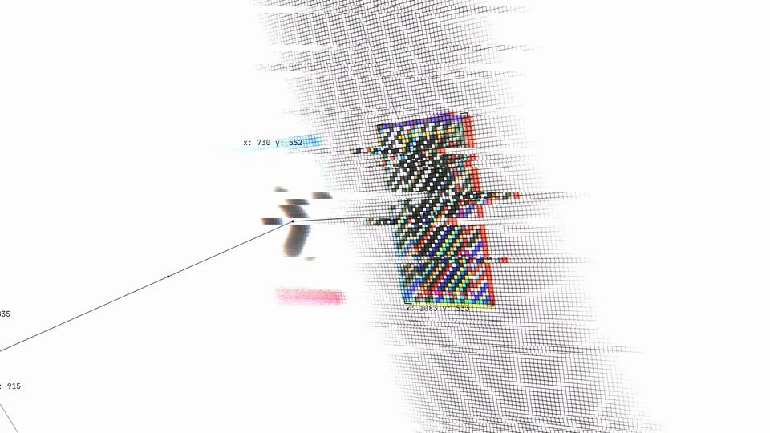
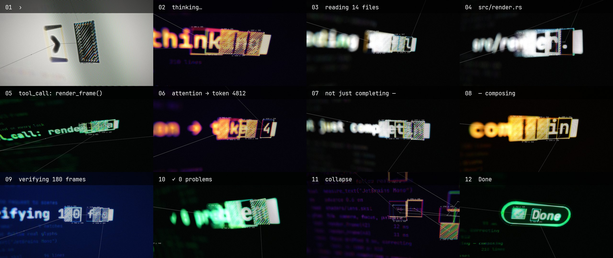
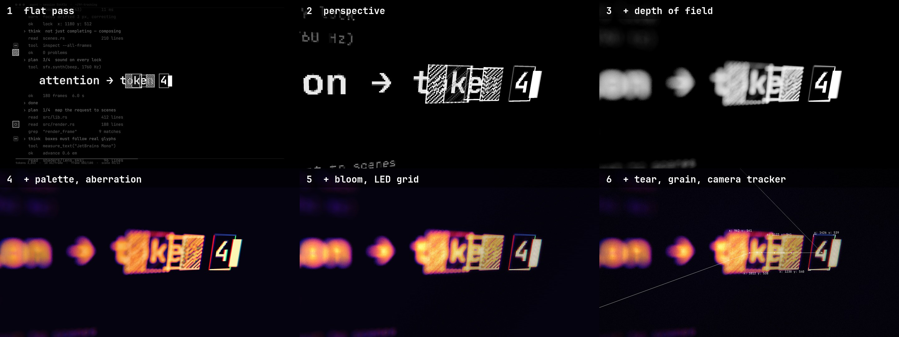

<div align="center">

# ff-tracking

**A virtual camera films an AI agent's screen while a tracker locks onto every glyph it types.**

Six seconds, two [fframes](https://github.com/dmtrKovalenko/fframes) passes, one SkSL shader.
No footage, no stock audio: every pixel and every sound comes from code.

[](https://github.com/dmtrKovalenko/fframes)
[](https://www.rust-lang.org)
[](https://skia.org)
[](LICENSE)

<a href="https://github.com/mrsarac/ff-tracking/releases/download/v1.0.0/tracking.mp4">
  
</a>

**[▶ Full 1080p with sound](https://github.com/mrsarac/ff-tracking/releases/download/v1.0.0/tracking.mp4)** ·
[On X](https://x.com/0xsarac/status/2108515856544317489) ·
[How it works](#how-it-works) ·
[Quick start](#quick-start)

**Part 2 → [ff-unmute](https://github.com/mrsarac/ff-unmute): the one you can unmute. Music written in code, every number on screen measured from the sound.**

<sub>fframes studies · <b>#1 ff-tracking</b> · <a href="https://github.com/mrsarac/ff-unmute">#2 ff-unmute</a>, the one you can unmute</sub>

</div>

---

## What you are looking at

An agent thinks out loud in a terminal: `thinking…` → `reading 14 files` →
`tool_call: render_frame()` → … → `✓ 0 problems` → `Done`. A computer-vision style tracker
follows the newest characters. A camera that never sits still films the screen up close.

- **Real coordinates.** Every `x: 1403 y: 559` label is the box's actual pixel position in
  that frame of the output. None of them are random numbers.
- **Focus that follows the tracker.** The focal plane is set by the box being tracked, so
  the depth of field racks along the line as the agent types.
- **Chain of thought, drawn.** Links run from box to box in reading order, and a dot runs
  along every link.
- **The lock.** Every shot ends with the newest word locking on: red for two frames, a
  scanline tear, a beep panned to where the box is.
- **Twelve shots, twelve looks.** A cut every 0.5 s through paper white, thermal, black
  and white, phosphor, amber, navy and neon.
- **A collapse and a landing.** Fourteen boxes fall into one, and that box becomes a
  `Done` pill before the fade to black.



## How it works

```text
hud ──► flat    pass 1: SVG, 3840×2160 ─────────► out/pass/flat.mp4 ──┐ iChannel0
 │                                                                      ▼
 ├────► lens    pass 2: SkSL on Skia Metal + camera tracker ──► out/tracking.mp4
 │                                                                      ▲ audio
 └────► tracks ──► out/tracks.json ──► sfx.py ──► out/pass/sfx.wav ─────┘
```

**Pass 1, `flat`**, draws the screen the way a terminal would: black, white, monospace, one
`<text>` per glyph, so the position of every character is known exactly. The tracker boxes
are on the screen itself. Some are hatched with an SVG pattern in `mix-blend-mode:
difference`, so the stripes turn dark where they cross a glyph. The only color is pure red,
and it marks a locked box. The pass renders at 2× because the lens magnifies it up to 3×.

**Pass 2, `lens`**, binds each frame of pass 1 as a shader input and films it. One SkSL
shader does everything physical:



1. **Perspective.** Every pixel shoots a ray at a tilted plane: real perspective, not an SVG skew.
2. **Depth of field.** The circle of confusion comes from the depth difference to the tracked
   target, with 36 golden-angle taps and highlights weighted like bokeh.
3. **Palette and aberration.** Brightness maps through five color stops per shot. R, G and B
   sample at radially shifted points, and the shift grows on a lock.
4. **Bloom and LED grid.** A wide ring of taps lifts everything around bright glyphs. The
   grid uses equal-area RGB stripes, so it adds no tint, and it fades out of focus.
5. **Tear, grain, camera tracker.** Rows slide on a lock and right after a cut. On top, the
   lens draws its own tracker sharp: links, labels and target brackets, projected with
   `hud::project`, the CPU copy of the shader's camera.

Both passes and the sound read the same `hud` crate, so the lens always knows where the
glyph it focuses on actually is.

**Sound**: `tools/sfx.py` reads `out/tracks.json` and synthesizes everything. It makes a
screen hum, a bit-crushed glitch on each cut, a click per keystroke and a pentatonic beep
per lock, panned to the box. It adds a riser into the collapse and a chime with a sub hit on
`Done`. Loudness is measured with ffmpeg's `ebur128` and set to -14 LUFS.

**Score** (optional): [`score/src/arrangement.rs`](score/src/arrangement.rs) is a second soundtrack, made in
[Slab](https://github.com/nooga/slab): a darker, heavier piece at 120 BPM, so every cut lands
on a beat. It reads the same `out/tracks.json`, plus `out/camera.json` from the `camera`
binary, so the mix follows the lens. The tracked box pans the lock blips and keystrokes, the
screen's slide pans the pad, riser and glitches, each zoom push opens the bass filter, and the
red lock frames tear the bass. See [Slab score](#slab-score).

## Quick start

macOS uses Metal; Linux and Windows use Vulkan. For Windows requirements and the
PowerShell render pipeline, see [Windows setup](docs/WINDOWS.md).

### Requirements

- Rust (2024 edition), ffmpeg and ffprobe on `PATH`.
- Python 3 with `numpy` and `scipy`, or [uv](https://docs.astral.sh/uv/)
  (`render.sh` uses `uv run --with numpy --with scipy` if the packages are missing).
- macOS: Apple silicon, Skia on Metal (the existing path).
- Linux: a Vulkan loader and GPU driver, plus a C/C++ toolchain, pkg-config,
  libclang, fontconfig and OpenGL development libraries for Skia. On Debian/Ubuntu:
  `sudo apt install build-essential pkg-config libclang-dev libfontconfig1-dev libgl1-mesa-dev libvulkan1 ffmpeg`.
  For NVIDIA, install your distribution's proprietary Vulkan-capable driver.
  Rust Skia normally downloads a prebuilt; a source build also needs Python and Ninja.
- README images additionally need Pillow and `img2webp`.

Linux uses Vulkan, not Metal. The default `FF_BACKEND=auto` tries the platform GPU
and reports a CPU fallback if context creation fails. To choose explicitly:

```bash
FF_BACKEND=gpu tools/render.sh  # Vulkan on Linux/Windows, Metal on macOS; no silent fallback
FF_BACKEND=cpu tools/render.sh  # no GPU context is created (also works with GPUs hidden)
```

The CPU flat pass uses fframes' tiny-skia SVG renderer. The CPU lens pass uses
fframes' `SkiaCpuCtx` raster compatibility backend, **not** tiny-skia, because
tiny-skia cannot run SkSL. The original lens shader still runs: perspective,
depth of field, palette, aberration, bloom, LED grid, tear and grain are retained.
This is slower, and SVG antialiasing/filter kernels can differ from the GPU pass.
Backend selection is printed to stderr; invalid values fail rather than choosing
a different backend. `FF_BACKEND` also works when invoking either binary directly.
`preview` still needs a GPU/window; the fallback is for offline rendering.

### Render

```bash
git clone https://github.com/mrsarac/ff-tracking && cd ff-tracking
tools/render.sh            # → out/tracking.mp4
```

`render.sh` builds the workspace, exports the tracks, renders pass 1, synthesizes the sound
and renders pass 2. It takes about 40 s on an M3 Pro, plus the first build.

Every pass is an fframes CLI, so the usual tools work on each of them:

```bash
target/release/lens strip all -n 12        # contact sheet of the final video
target/release/lens frame 81 -o frames     # one full-size frame
target/release/lens preview                # real-time window with sound
target/release/lens audio analyze          # loudness, true peak
LENS_STAGE=1 target/release/lens frame 81  # stop the shader after a step (0-3), as in the image above
python3 -I tools/readme_media.py           # rebuild the images in this README
```

## Slab score

`tools/score.sh` is `render.sh` with the Slab score in place of `sfx.py`:

```bash
tools/score.sh                          # uses the committed render, score/score.wav
SLAB=/path/to/slab tools/score.sh       # renders the score again from Rust
SLAB=/path/to/slab SCORE_IMPL=python tools/score.sh  # original Python reference
```

Rendering needs a [Slab](https://github.com/nooga/slab) checkout built with
`zig build -Doptimize=ReleaseFast`. The Rust `score` crate uses the MIT-licensed
[slabkit-rs](https://github.com/nooga/slabkit-rs) library to write the project
`score/ff_tracking.slab`, which opens in Slab's arrangement and mixer, and renders it headless.
The render runs past the picture for the reverb tail, so `score.sh` cuts it at 6 s and fades
it with the fade to black. It comes out around -10.7 LUFS with a -1 dBTP true peak.

Generate just the editable project, or render it separately:

```bash
SLAB=/path/to/slab cargo run -p score
SLAB=/path/to/slab cargo run -p score -- --render --stems
cargo run -p score -- --help
```

The Rust port reproduces the committed Python project's complete JSON values,
including Python's seeded random notes, note rounding, colors, clip names and
automation ordering. `cargo test -p score` checks every field against the existing
project using fixed resource fixtures; it needs neither Slab nor Python. For a
live comparison against your Slab resources, including changed camera/event
inputs and identical float32 renders, run:

```bash
SLAB=/path/to/slab python3 tools/check_score.py --render
```

Python is used only by the optional reference/comparison path; the Rust score
and `tools/score.sh` need no Python packages when `SLAB` is set. Python remains
part of the default `tools/render.sh` sound pipeline.

| File | What it is |
|---|---|
| `hud/src/bin/camera.rs` | writes `out/camera.json`: per frame, the zoom, tilt and roll, the tracked box's position in the output and where the filmed screen's centre lands |
| `score/src/arrangement.rs` | the Rust score: reads camera/event data via slabkit-rs, writes the same Slab project |
| `score/score.py` | unchanged Python reference for the score |
| `tools/check_score.py` | live Python/Rust project and optional render parity check |
| `score/ff_tracking.slab/` | the generated Slab project (tracks, notes, automation, effects) |
| `score/score.wav` | the score rendered and cut to 6 s, 48 kHz, so the video builds without Slab |
| `tools/score.sh` | the whole pipeline with the score |

Change a shot and run `SLAB=… tools/score.sh`: the hits, pans and filter moves follow the
new timing and camera.

The Slab score is by [nooga (@MGasperowicz)](https://x.com/MGasperowicz/status/2108692059431342428),
the author of Slab, contributed in [#1](https://github.com/mrsarac/ff-tracking/pull/1); how it was made
is in [#2](https://github.com/mrsarac/ff-tracking/issues/2).

**License note:** `score/score.py` imports `slabkit`, which ships with Slab under GPL-3.0. slabkit is not
part of this repo and Slab is needed only to re-render the score. Its author offers `score/score.py`,
the project in `score/ff_tracking.slab/` and `score/score.wav` under this repo's MIT license.
The Rust score and `slabkit-rs` are MIT licensed and invoke Slab as an external
renderer. The MT19937 algorithm keeps its BSD notice in `licenses/MT19937.txt`.

## Make it yours

Every shot is one entry in `SCENE_LIST` in [`hud/src/lib.rs`](hud/src/lib.rs):

```rust
SceneDef {
    kind: Kind::Typing,
    text: "thinking…",                     // what the agent types
    palette: Palette::Thermal,             // Paper, Thermal, Mono, Phosphor, Amber, Navy, Neon
    //         tilt_x tilt_y  roll  zoom 0→1  pan x, y  blur
    cam: cam(0.38, -0.22, 0.04, 2.5, 2.8, 50.0, 0.0, 1.2),
    hero: (560.0, 540.0),                  // where the line starts on the flat screen
    size: 104.0,                           // font size
},
```

Change the text, a palette or the camera, run `tools/render.sh`, and the tracker, focus,
labels and beeps all follow. `cargo test -p hud` checks that every line fits the screen and
that the camera keeps every target in frame.

## Community

I open-sourced this on a Friday. This is what people made with it since.

- [@MGasperowicz](https://x.com/MGasperowicz/status/2108692059431342428) (nooga) scored it in [Slab](https://github.com/nooga/slab). The score lives in this repo: [#1](https://github.com/mrsarac/ff-tracking/pull/1), and how he made it is in [#2](https://github.com/mrsarac/ff-tracking/issues/2).
- [@tanzim31](https://x.com/tanzim31/status/2108701207674208744) rendered a promo video for alt.r with it on Windows.
- [@TheoGavriilidis](https://x.com/TheoGavriilidis/status/2108615586653823133) made "AI vs SI".
- [@joinmorse](https://x.com/joinmorse/status/2108626603513401652) made their own tracker version for Morse.
- [@isitqday](https://x.com/isitqday/status/2109106777321283940) used it for the HUD in a music video ([how](https://x.com/isitqday/status/2109113355239842060)).
- [@PurzBeats](https://x.com/PurzBeats/status/2110001806319526048) made a kinetic-typography lyric video with it.

Made your own version? Open an issue or tag [@0xsarac](https://x.com/0xsarac) and it goes here.

## Layout

```text
hud/           shots, tracker boxes, camera per frame, projection (no fframes dependency)
flat/          pass 1: the screen, 3840×2160
lens/          pass 2: lens/shaders/lens.sksl and the camera-space tracker
tools/         render.sh (whole pipeline), sfx.py (sound), readme_media.py (these images),
               score.sh (the pipeline with the Slab score)
score/         the Rust Slab score crate, Python reference, ff_tracking.slab project, score.wav
docs/          design spec, prompts and decisions, fframes contributions
```

## Notes from the build

- A synced video frame is a regular image for a shader:
  `.image("iChannel0", &frame.get_synced_video_frame(..)?.into_image())`. That is what makes
  the two-pass camera possible.
- `flat` is a reserved word in SkSL (a GLSL ES interpolation qualifier), so name helpers
  something else.
- At the `Video` level, never return `Svgr::empty()`; return a root `<svg>`. An empty root is
  an error, and late in a Skia render it surfaces only after the encoders drain
  ([fframes#209](https://github.com/dmtrKovalenko/fframes/issues/209)).
- The two passes exist because a shader can't yet sample an SVG subtree of the same frame.
  [fframes#210](https://github.com/dmtrKovalenko/fframes/issues/210) proposes that.

## Credits

- Visual style inspired by [Michael Nowak (@mnowakdesign)](https://x.com/mnowakdesign/status/2108253918086176899).
  None of his footage is used.
- Slab score (optional soundtrack): [nooga](https://github.com/nooga), made in [Slab](https://github.com/nooga/slab).
- Built on [fframes](https://github.com/dmtrKovalenko/fframes) by Dmitriy Kovalenko, rendering with
  [Skia](https://skia.org), encoding with [FFmpeg](https://ffmpeg.org).
- Font: [JetBrains Mono](https://github.com/JetBrains/JetBrainsMono) (SIL OFL 1.1, see
  [`licenses/JetBrainsMono-OFL.txt`](licenses/JetBrainsMono-OFL.txt)).
- Made with Claude Code. [`docs/PROMPT.md`](docs/PROMPT.md) is the prompt that makes this video,
  and the design is in [`docs/superpowers/specs/`](docs/superpowers/specs/2026-10-09-tracking-hud-design.md).

## License

[MIT](LICENSE) © 2026 Mustafa Saraç. The font keeps its own license.
